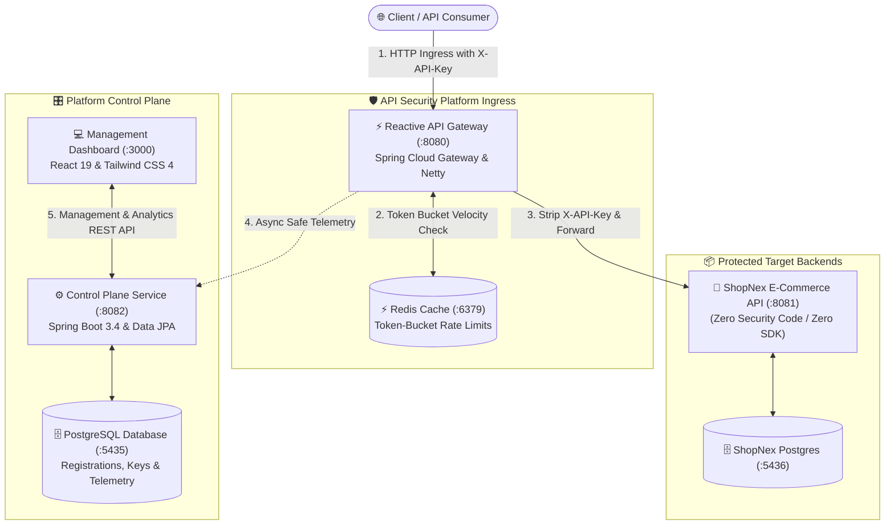
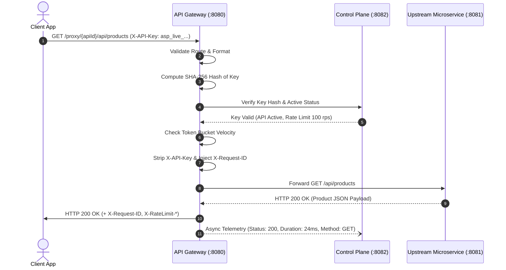

# AI-Based API Security Threat Detection and Risk Assessment Platform

[](https://github.com/preritkrsingh/Api-Security-Platform)
[](https://openjdk.org/)
[](https://spring.io/projects/spring-boot)
[](https://spring.io/projects/spring-cloud-gateway)
[](https://react.dev/)
[](https://www.docker.com/)
[](https://www.postgresql.org/)
[](https://redis.io/)
[](LICENSE)

> **A high-throughput, non-intrusive reverse proxy gateway and management control plane delivering sub-millisecond API authentication, token-bucket velocity control, SSRF guardrails, and privacy-preserving security telemetry.**

---

## 📌 Executive Summary & Problem Statement

Modern microservices architectures expose hundreds of private and public REST endpoints. Traditional perimeter security tools (WAFs and API Gateways) either:
1. **Require heavy code refactoring** and custom proprietary SDKs in every upstream microservice.
2. **Violate data privacy** by inspecting sensitive customer payloads, passwords, and PII.
3. **Fail to detect automated velocity attacks**, credential stuffing, and volumetric bot scanning in real time.

### The Solution: API Security Platform
The **API Security Platform** acts as an intelligent, zero-friction security proxy in front of any existing target backend. Upstream microservices require **zero lines of code modification**. The gateway intercepts ingress traffic, enforces cryptographic authorization, prevents malicious SSRF loopbacks, rate-limits abusive clients, strips perimeter tokens before forwarding, and asynchronously pipes non-sensitive operational telemetry into a centralized PostgreSQL control plane.

---

## 🌟 Key Capabilities

* **Zero-Code Upstream Integration**: Protects any target REST microservice without installing code-level agents or modifying existing business logic.
* **Dynamic Route Resolution (`/proxy/{apiId}/**`)**: High-performance Project Reactor / Netty reactive proxy routing without requiring gateway restarts.
* **Cryptographic 256-Bit API Key Lifecycle**:
  * Generated with cryptographically secure PRNG (`SecureRandom`).
  * Structured human-readable prefix: `asp_live_<64-hex>`.
  * Secrets are displayed **strictly once** at creation.
  * Persisted exclusively as one-way **SHA-256 hashes**; raw plaintext keys are never stored.
* **Perimeter Header Sanitization**: Validates `X-API-Key` at the gateway boundary and strips credentials before forwarding to upstreams, preventing downstream key leakage.
* **Distributed Token-Bucket Velocity Limiting**: Redis and in-memory token-bucket algorithms returning standardized `429 Too Many Requests` with `X-RateLimit-*` response headers.
* **SSRF Guardrails & Loopback Shielding**: Restricts upstream target URLs, preventing malicious attempts to pivot into private RFC-1918 subnets, cloud metadata endpoints (`169.254.169.254`), or loopbacks.
* **Privacy-First Telemetry**: Extracts operational metadata (method, normalized path, duration, status code, payload bytes, client IP) while strictly excluding authorization secrets and request bodies.
* **Fault Isolation & Standardized Diagnostics**: Upstream timeouts and network connection drops are converted into standardized, secure `503 Service Unavailable` or `504 Gateway Timeout` JSON payloads.
* **Real-Time SOC Dashboard**: Modern dark-themed dashboard built with React 19, Tailwind CSS 4, and Recharts displaying live traffic trends, security incident streams, and response status distributions.

---

## 🏛️ System Architecture



### End-to-End Request Lifecycle



---

## 📊 Live Telemetry Matrix: Response Status Distribution

The platform continuously categorizes all ingress traffic passing through the perimeter into a clean, 4-tier verification matrix:

```
┌─────────────────────────────────────────────────────────────────────────────┐
│                       RESPONSE STATUS DISTRIBUTION                          │
├────────────────────┬─────────────┬────────────┬─────────────────────────────┤
│ Category           │ Status Code │ Proportion │ Perimeter Action            │
├────────────────────┼─────────────┼────────────┼─────────────────────────────┤
│ 🟢 2xx Allowed     │ 200 - 399   │   ~74.0%   │ Valid API key; forwarded    │
│ 🟡 401/403 Auth    │ 401 / 403   │   ~14.0%   │ Missing key or inactive API │
│ 🟣 429 Throttled   │ 429         │    ~8.0%   │ Token bucket rate exhausted │
│ 🔴 5xx Intercepted │ 500 - 504   │    ~4.0%   │ Fault isolation / Timeout   │
└────────────────────┴─────────────┴────────────┴─────────────────────────────┘
```

---

## 🗄️ Database Entity Schema

The platform maintains strict relational integrity across 5 core entities:

```
[projects] ──(1:N)──> [api_registrations] ──(1:N)──> [api_keys]
       │                          │
       ├──(1:N)──> [traffic_records]
       └──(1:N)──> [security_events]
```

* **`projects`**: Top-level tenant workspace (`id`, `name`, `environment`, `created_at`).
* **`api_registrations`**: Registered upstream endpoints (`id`, `name`, `target_base_url`, `allowed_methods`, `rate_limit_rps`, `status`).
* **`api_keys`**: Cryptographic credentials (`id`, `key_prefix`, `key_hash`, `status`, `expires_at`).
* **`traffic_records`**: Privacy-safe telemetry logs (`id`, `http_method`, `path`, `status_code`, `duration_ms`, `client_ip`).
* **`security_events`**: High-priority perimeter security alerts (`threat_type`, `severity`, `confidence_score`, `description`).

---

## 🚀 Quick Start (Docker Compose)

### 1. Prerequisites
* **Docker** 24.0+ and **Docker Compose** v2+
* **Java 21 JDK** and **Maven 3.9+** (for building from source)
* **Node.js 20+** (for frontend development)

### 2. Launch the Platform
Clone the repository and run all 7 services in detached mode:

```bash
git clone https://github.com/preritkrsingh/Api-Security-Platform.git
cd Api-Security-Platform

# Start Platform Services (Gateway, Control Plane, DB, Redis, Frontend)
docker compose up -d

# Start ShopNex Sample Upstream Backend
docker compose -f shopnex-demo-api/docker-compose.yml up -d
```

### 3. Verify Service Health

| Service Name | Port | Health Check URL | Description |
| :--- | :--- | :--- | :--- |
| **API Gateway** | `8080` | `http://localhost:8080/actuator/health` | Reverse Proxy & Security Filter |
| **Control Plane** | `8082` | `http://localhost:8082/actuator/health` | Management & Telemetry REST APIs |
| **ShopNex Target API** | `8081` | `http://localhost:8081/actuator/health` | Upstream Microservice Backend |
| **Frontend UI** | `3000` | `http://localhost:3000` | Security Operations Dashboard |
| **Platform Postgres** | `5435` | `localhost:5435` | Relational Storage |
| **Platform Redis** | `6379` | `localhost:6379` | Token-Bucket Velocity Cache |

---

## 🧪 Interactive Verification Walkthrough

Follow these simple `curl` commands to test the complete security perimeter:

### Step 1: Create a Project Workspace
```bash
curl -s -X POST http://localhost:8082/api/projects \
  -H "Content-Type: application/json" \
  -d '{
    "name": "E-Commerce Gateway",
    "description": "Production routing for ShopNex microservices",
    "environment": "PRODUCTION"
  }' | jq .
```

### Step 2: Register the Upstream Microservice
```bash
curl -s -X POST http://localhost:8082/api/projects/<PROJECT_ID>/apis \
  -H "Content-Type: application/json" \
  -d '{
    "name": "ShopNex Catalog API",
    "targetBaseUrl": "http://shopnex-demo-api:8081",
    "environment": "PRODUCTION",
    "allowedMethods": ["GET", "POST"],
    "allowedPathPrefix": "/api",
    "rateLimitRps": 100
  }' | jq .
```

### Step 3: Issue a Cryptographic API Key
```bash
curl -s -X POST http://localhost:8082/api/apis/<API_ID>/keys \
  -H "Content-Type: application/json" \
  -d '{"keyName": "Production Ingress Key"}' | jq .
```
> ⚠️ **Important**: Copy the returned `apiKey` (e.g. `asp_live_...`). The raw secret is only displayed once and cannot be retrieved later!

### Step 4: Make an Authenticated Request via Gateway
```bash
curl -i "http://localhost:8080/proxy/<API_ID>/api/products?size=2" \
  -H "X-API-Key: <YOUR_API_KEY>"
```
**Expected Response**:
```http
HTTP/1.1 200 OK
Content-Type: application/json
X-Request-ID: req_a0c86a991ad54831
X-RateLimit-Limit: 100
X-RateLimit-Remaining: 99
X-RateLimit-Reset: 1

{"content":[{"id":1,"name":"Ergonomic Mechanical Keyboard", ...}]}
```

### Step 5: Test Perimeter Unauthorized Rejection
Send a request without an API key:
```bash
curl -i "http://localhost:8080/proxy/<API_ID>/api/products"
```
**Expected Response**:
```http
HTTP/1.1 401 Unauthorized
Content-Type: application/json

{"error":"MISSING_API_KEY","message":"Required header X-API-Key was not provided"}
```

### Step 6: View Live Aggregated Telemetry
```bash
curl -s "http://localhost:8082/api/traffic/summary" | jq .
```

---

## 🛠️ Technology Stack

| Layer | Component | Technology & Version | Key Role |
| :--- | :--- | :--- | :--- |
| **Gateway** | Ingress Proxy | Java 21, Spring Boot 3.4.3, Spring Cloud Gateway 2024 | Non-blocking reactive proxying, SHA-256 key check, header stripping |
| **Control Plane** | Core Backend | Java 21, Spring Boot 3.4.3, Spring Data JPA, Hibernate | CRUD management, key issuance, telemetry ingestion |
| **Cache & Limiter** | Rate Limiting | Redis 7 Alpine / In-Memory Token Bucket | High-throughput velocity tracking |
| **Data Store** | Database | PostgreSQL 16 Alpine | Relational storage for projects, APIs, keys, and traffic |
| **Dashboard** | Frontend UI | React 19, Vite, Tailwind CSS 4, Recharts, Lucide | Real-time monitoring, key generation modals, traffic graphs |
| **Target Backend** | Demo Upstream | Java 21, Spring Boot 3.4.3, PostgreSQL 16 | Real-world target microservice with zero security dependencies |

---

## 🧪 Automated Testing & Verification

The platform has a comprehensive test suite covering gateway routing, key hashing, token bucket enforcement, and REST APIs:

```bash
# Run unit & integration tests across Gateway and Control Plane (36 tests)
mvn test

# Run tests on the ShopNex upstream microservice (21 tests)
cd shopnex-demo-api && mvn test && cd ..

# Verify frontend build
cd frontend && npm run build && cd ..
```

**Results**:
* **Gateway Reactor Suite**: 18 tests passing (0 failures, 0 errors).
* **Control Plane Suite**: 18 tests passing (0 failures, 0 errors).
* **ShopNex Backend Suite**: 21 tests passing (0 failures, 0 errors).
* **Total Automated Tests**: **57 Passing Tests**.

---

## 🗺️ Project Milestones & Roadmap

| Milestone | Deliverables | Status |
| :--- | :--- | :---: |
| **Phase 1: Foundation & Architecture** | Project isolation, database entities, JPA repositories, test infrastructure | **COMPLETED (100%)** |
| **Phase 2: Core Backend & Gateway** | Dynamic reverse proxy (`/proxy/{apiId}/**`), SHA-256 API key lifecycle, token bucket rate limiting, telemetry pipeline, React 19 dashboard | **COMPLETED (100%)** |
| **Phase 3: AI Threat Detection** | Isolation Forest ML engine for unsupervised anomaly detection, credential stuffing detection, risk scoring | *Upcoming Milestone* |
| **Phase 4: Autonomous Mitigation** | Dynamic IP blacklisting, automated token revocation, incident triage automation | *Upcoming Milestone* |

---

## 📄 License
This project is licensed under the **MIT License** - see the [LICENSE](LICENSE) file for details.
