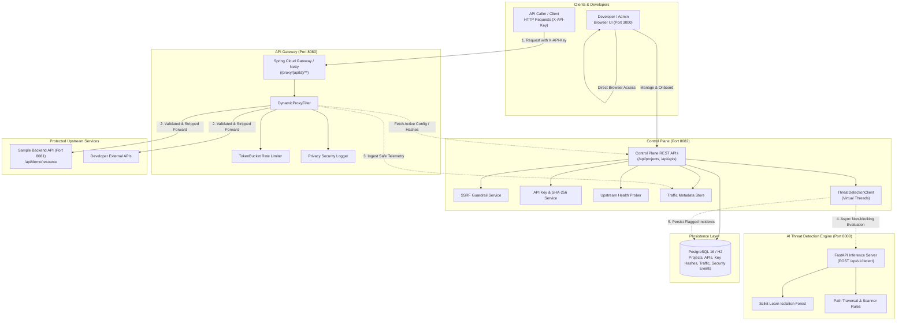

# System Architecture Overview
## AI-Based API Security Threat Detection and Risk Assessment Platform

### 1. Executive Summary

The **AI-Based API Security Threat Detection and Risk Assessment Platform** is an enterprise API security platform that combines a high-throughput dynamic reverse proxy API gateway with an intelligent onboarding control plane and machine-learning threat detection capabilities.

The platform delivers:
1. **Control Plane Management**: Centralized project lifecycle, API registration, environment tagging, and protection policies.
2. **Dynamic Reverse Proxy Gateway**: Dynamic routing for registered APIs via `/proxy/{apiId}/**` with credential validation, HTTP method and path enforcement, request body bounds, and token-bucket rate limiting.
3. **SSRF Guardrails**: Comprehensive destination IP filtering preventing internal network probing and cloud metadata theft (`169.254.169.254`).
4. **Cryptographic Credential Management**: Cryptographically secure API keys hashed with SHA-256 (plaintext key never stored or re-exposed).
5. **Safe Telemetry Extraction**: Non-sensitive operational metadata collection omitting body payloads and credentials.
6. **AI Threat Detection Engine**: Python FastAPI microservice utilizing Scikit-learn Isolation Forest and heuristics to detect path traversal, scanning tools, and anomalies out-of-band.
7. **Asynchronous ML Evaluation**: Java 21 virtual threads dispatching telemetry to the AI engine asynchronously without adding a single millisecond of latency to client proxy requests.
8. **Onboarding UI**: Sleek, responsive React 18 + Tailwind CSS interface with 9 operational sections, live connectivity testing, interactive gateway console, and zero mock fallback data.

---

### 2. High-Level Architecture Diagram

---

### 3. Logical Component Roles

| Logical Component | Port | Technology | Primary Responsibilities |
|---|:---:|---|---|
| **API Gateway** | `8080` | Spring Cloud Gateway 2024.0.0, Project Reactor, Netty | Dynamic routing `/proxy/{apiId}/**`, credential verification, method/path enforcement, rate limiting, header sanitization, fault isolation. |
| **Control Plane** | `8082` | Spring Boot 3.4.3, Spring Data JPA, Virtual Threads | Project management, API registration, SSRF validation, cryptographic key generation, connectivity probing, safe traffic telemetry ingestion, security event logging. |
| **Threat Detection Engine** | `8000` | Python 3.11, FastAPI, Scikit-learn, Pandas | Out-of-band statistical anomaly detection via Isolation Forest, heuristic scanner and traversal rules, risk assessment scoring (0.0–1.0). |
| **Protected Upstream API** | `8081` | Spring Boot 3.4.3 | Sample business API exposing health and demo resource payloads for validation. |
| **Relational Database** | `5435` / `5432` | PostgreSQL 16 (H2 fallback for tests) | ACID persistence for projects, API registrations, credential hashes, safe traffic records, and security incidents. |
| **Security Dashboard UI** | `3000` | React 18, Tailwind CSS, Vite | Developer user interface with 9 views: Overview, Projects, APIs, Traffic Monitoring, Threat Detection, Risk Assessments, Security Policies, Settings, Help. Zero mock data. |

---

### 4. Key Security & Architectural Invariants

1. **Strict Upstream Credential Isolation**: The gateway strips all platform API keys (`X-API-Key`) before proxying traffic upstream to prevent third-party credential leakage.
2. **Zero Plaintext Secret Storage**: API keys are hashed with SHA-256 upon generation. Plaintext keys are never stored in the database and never logged.
3. **Decoupled Data and Management Planes**: The gateway caches active API configurations and key hashes locally with configurable TTL, ensuring microsecond routing decisions even during transient control plane downtime.
4. **Privacy-Preserving Telemetry**: Request/response bodies and authorization headers are strictly excluded from logging and telemetry.
5. **Zero-Latency ML Inference**: Machine learning evaluation runs completely out-of-band via asynchronous Java 21 virtual threads, ensuring that AI inference never slows down client proxy traffic.
6. **SSRF Boundary Enforcement**: All upstream URLs are validated server-side against DNS resolution, loopback addresses, private RFC 1918 subnets, and cloud instance metadata addresses (`169.254.169.254`).
