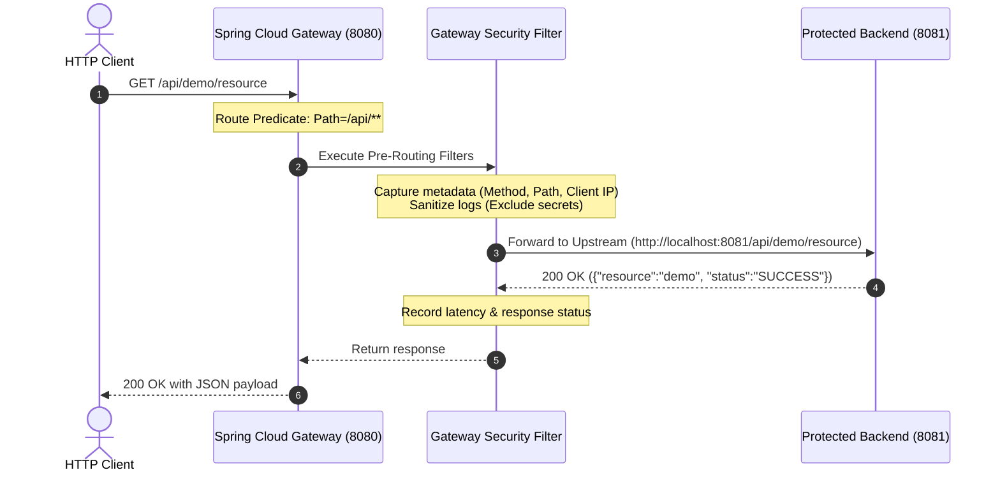
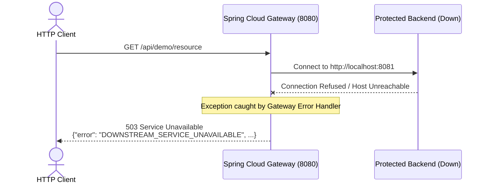
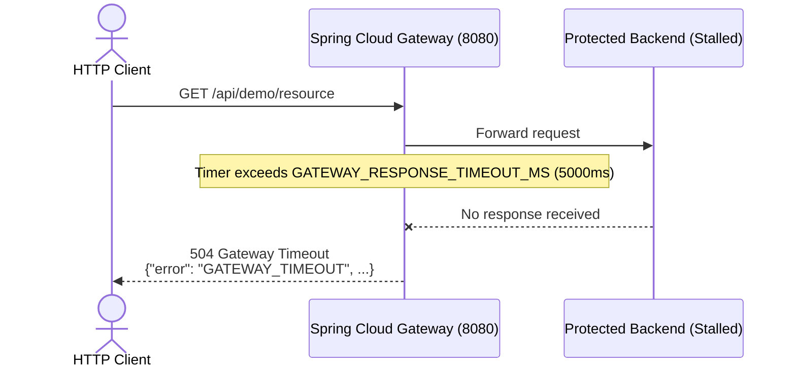
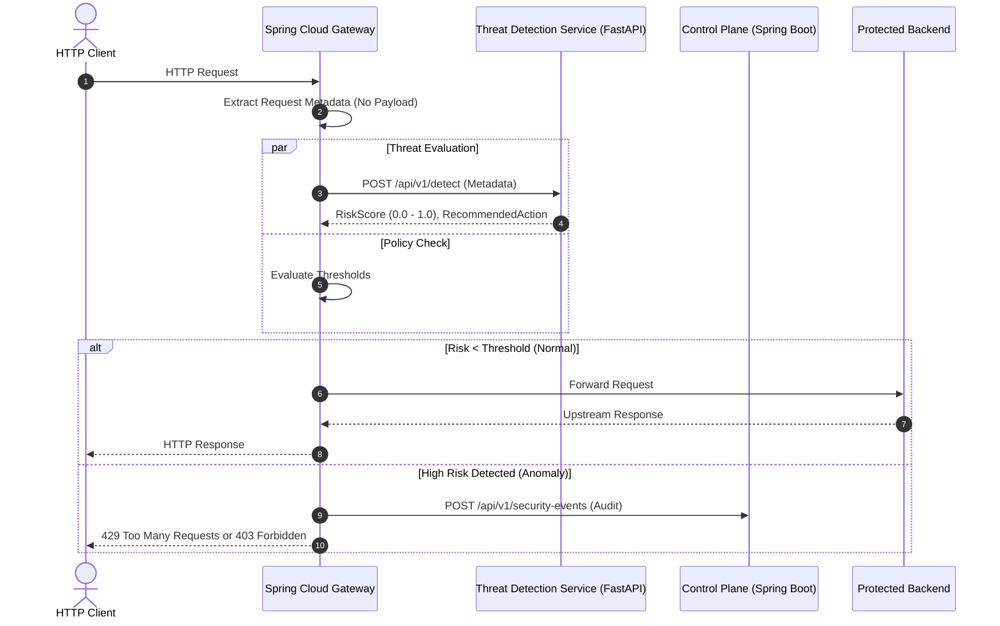

# System Request Flow Specification

This document details the HTTP request and response lifecycles through the **AI-Based API Security Threat Detection and Risk Assessment Platform**.

---

## 1. Phase 2 Implemented Request Flow (Current Baseline)

In Phase 2, the core gateway routing and upstream communication path are established and verified:

### Detailed Execution Steps:
1. **Client Request**: The HTTP client sends a request to the API Gateway at port `8080` (e.g., `GET /api/demo/resource`).
2. **Route Matching**: The Spring Cloud Gateway route locator evaluates route predicates. The `/api/**` predicate matches the request.
3. **Pre-Filtering & Security Sanitization**:
   - The Gateway executes global filters.
   - Request metadata is extracted (HTTP method, normalized URI path, client remote IP, content length).
   - Sensitive headers (`Authorization`, `Cookie`, `X-API-Key`) and request bodies are strictly excluded from logging.
4. **Upstream Forwarding**: The Gateway's Netty HTTP client opens a connection to the configured backend URL (`BACKEND_URL`, default `http://localhost:8081`) and transmits the request.
5. **Backend Processing**: The protected sample backend's `ApiController` handles the request and returns a structured JSON response (`200 OK`).
6. **Post-Filtering**: The Gateway completes latency measurements, logs the access record (safe metadata only), and streams the response back to the client.

---

## 2. Resilience & Error Handling Flows

### 2.1 Upstream Down / Connection Failure

When the upstream service is offline, the gateway intercepts the `ConnectException` or `AnnotatedConnectException` and returns a clean, structured `503 Service Unavailable` JSON response rather than dropping the socket or exposing internal Java stack traces.

### 2.2 Upstream Timeout Handling

If the upstream backend fails to respond within the configured timeout window (`GATEWAY_RESPONSE_TIMEOUT_MS`), the gateway terminates the upstream socket and returns a clean `504 Gateway Timeout` JSON response.

---

## 3. Future Integrated Threat Assessment Flow (Phase 3 & 4)

In later phases, the threat detection engine and control plane are actively engaged:

